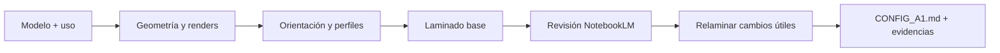

# 3D-maestro

[](https://github.com/cortins-05/3D-maestro/actions/workflows/ci.yml)
[](https://github.com/cortins-05/3D-maestro/releases)
[](LICENSE)

**De un modelo 3D a una configuración de impresión razonada para tu Bambu Lab A1.**

Una skill para agentes de IA que analiza la geometría, genera vistas y mapas de voladizos, compara orientaciones, lamina con Bambu Studio y contrasta las mejoras con las fuentes de tu cuaderno de NotebookLM. Cada cambio de ajuste lleva su motivo; los tiempos y gramos proceden del laminador cuando está disponible.

> **Recomendamos instalarla a nivel global de usuario**: estará disponible en todos tus proyectos sin duplicar scripts y referencias. No necesitas permisos de administrador. La instalación global de la *skill* no equivale a `npm install -g`.

English: an AI agent skill for Bambu Lab A1 print planning, geometry analysis, real slicing and source-grounded NotebookLM review. The agent replies in your language; documentation and technical references are primarily Spanish.

## Instalación rápida

Con Node.js 22+ (incluye npm/npx) y Git instalados:

```bash
# Codex · global de usuario (recomendado)
npx --yes github:cortins-05/3D-maestro#v1.1.1 install --global --agent codex

# Claude Code
npx --yes github:cortins-05/3D-maestro#v1.1.1 install --global --agent claude-code

# Cursor
npx --yes github:cortins-05/3D-maestro#v1.1.1 install --global --agent cursor
```

Se descarga una versión etiquetada desde GitHub. **No requiere una cuenta de npm ni un paquete publicado en su registro.** El instalador no tiene dependencias npm ni scripts `postinstall`; copia la skill, referencias, scripts Python y archivos de requisitos. La instalación no configura las herramientas externas ni inicia sesión en Google. Completa los requisitos siguientes y vuelve a abrir el agente.

| Destino | Instalación global | Instalación de proyecto (`--project`) |
| --- | --- | --- |
| `codex` (por defecto) | `$CODEX_HOME/skills` o `~/.codex/skills` | `.codex/skills` |
| `claude-code` | `~/.claude/skills` | `.claude/skills` |
| `cursor` | `~/.cursor/skills` | `.cursor/skills` |
| `agents` | `~/.agents/skills` | `.agents/skills` |

Siempre añade la subcarpeta `3d-maestro`. Usa `--dir "/ruta/a/skills"` para otro agente que admita `SKILL.md`. La compatibilidad exige acceso a terminal, ejecución de Python y lectura de imágenes; instalar archivos no concede esos permisos al agente.

## Requisitos

| Requisito | Para qué sirve | Obligatorio |
| --- | --- | --- |
| Agente compatible con skills, terminal e imágenes | Ejecutar el flujo e interpretar los renders | Sí |
| Node.js 22+ con npm/npx y Git | Ejecutar el instalador desde GitHub | Para instalar por `npx` |
| Python 3.11+ y paquetes de `requirements.txt` | Analizar modelos y generar renders | Sí |
| Bambu Studio con perfiles BBL de la A1 | Laminar y medir tiempo, consumo y ajustes efectivos | Para validación real |
| CLI `nlm` del proyecto `notebooklm-mcp-cli` | Consultar NotebookLM / Gemini Notebook | Para la revisión completa |
| Sesión de Google válida en `nlm` | Acceder al cuaderno con el perfil correcto | Para NotebookLM |
| Skill de NotebookLM instalada para tu agente | Autenticación, comandos y recuperación de errores | Para NotebookLM |
| Cuaderno propio «Bambu Lab», o uno configurado, con fuentes útiles | Sustentar las recomendaciones | Para NotebookLM |
| Conexión a Internet | Instalación y consulta a NotebookLM | Según la fase |
| `cascadio` (`requirements-step.txt`) | Importar STEP/STP | Solo para esos formatos |

Sin Bambu Studio, el agente debe indicar **«no validado»**. Sin NotebookLM disponible o con sesión caducada, entrega el trabajo realizado como **«Revisión NotebookLM pendiente: motivo»**. Ninguno de estos casos permite inventar resultados.

### 1. Python y análisis geométrico

Recomendamos un entorno virtual. Ejemplo para Codex global con su ruta predeterminada:

**Windows / PowerShell**

```powershell
python -m venv "$env:USERPROFILE/.venvs/3d-maestro"
& "$env:USERPROFILE/.venvs/3d-maestro/Scripts/Activate.ps1"
python -m pip install -r "$env:USERPROFILE/.codex/skills/3d-maestro/requirements.txt"
```

**macOS / Linux**

```bash
python3 -m venv ~/.venvs/3d-maestro
source ~/.venvs/3d-maestro/bin/activate
python -m pip install -r ~/.codex/skills/3d-maestro/requirements.txt
```

Cambia la ruta por la que imprime el instalador si usas otro agente o `CODEX_HOME`. Abre el agente desde ese entorno, o indícale la ruta absoluta de su intérprete Python. Para STEP/STP instala `requirements-step.txt` en el mismo entorno; la disponibilidad de las ruedas de `cascadio` depende del sistema y versión de Python. Si falla, exporta el modelo como STL o 3MF.

Dependencias: `trimesh`, `numpy`, `matplotlib`, `scipy`, `rtree`, `networkx` y `lxml` (lectura de 3MF). Los scripts de geometría y laminado pueden trabajar sin Internet una vez instalados.

### 2. Bambu Studio

Instala [Bambu Studio](https://bambulab.com/en/download/studio) y comprueba que incluye la **Bambu Lab A1** y los perfiles de proceso y filamento que utilizarás. No necesitas conectar la impresora ni iniciar sesión en Bambu Cloud para este flujo local.

El script busca ubicaciones habituales en Windows y macOS; en Linux busca ejecutables en `PATH` y algunas ubicaciones de AppImage. Si no detecta el ejecutable o sus perfiles, define:

| Variable | Contenido |
| --- | --- |
| `BAMBU_STUDIO` | Ruta absoluta al ejecutable real de Bambu Studio |
| `BAMBU_PROFILES` | Carpeta `profiles/BBL` que contiene `machine/`, `process/` y `filament/` |

En PowerShell: `$env:BAMBU_STUDIO = 'C:/Program Files/Bambu Studio/bambu-studio.exe'`. En bash/zsh: `export BAMBU_STUDIO='/ruta/al/ejecutable'`. Configura las variables antes de abrir el agente para que las herede.

En Linux, una AppImage puede necesitar extracción para acceder a los perfiles; Flatpak puede requerir un wrapper ejecutable y `BAMBU_PROFILES` explícito. Las bibliotecas gráficas o un servidor de pantalla virtual pueden ser necesarios incluso con la CLI. La disponibilidad en cada plataforma depende de la distribución de Bambu Studio. Las pruebas automáticas no instalan el slicer comercial ni garantizan todas sus versiones.

### 3. NotebookLM: CLI, skill y autenticación

La dependencia correcta es [**notebooklm-mcp-cli**](https://github.com/jacob-bd/gemini-notebook-mcp-cli), cuyo comando es **`nlm`**. No es `notebookkm-cli` ni el paquete distinto `notebooklm-py`.

Instala con [uv](https://docs.astral.sh/uv/getting-started/installation/) (requiere tener `uv` disponible) o con pipx:

```bash
uv tool install notebooklm-mcp-cli
# Alternativa, si ya tienes pipx:
# pipx install notebooklm-mcp-cli

# Instala su skill a nivel usuario para Codex/agentes compatibles:
nlm skill install agents --level user
# Para Claude Code:
# nlm skill install claude-code --level user
# Para Cursor, consulta los destinos admitidos por tu versión:
# nlm skill install --help

# Completa el acceso a Google en el navegador que abra nlm:
nlm login --profile default
nlm login --check --profile default
nlm notebook list --json --profile default
```

**Debes estar autenticado en `nlm`**, no solo en la web de NotebookLM. El login necesita un navegador compatible; una sesión puede caducar. Ante un error, comprueba primero la conexión y después vuelve a ejecutar `nlm login --profile default` si es necesario. No copies cookies ni tokens al repositorio ni al chat.

La skill auxiliar puede aparecer como `nlm-skill` o `notebooklm-cli` según la versión y el destino. Comprueba su visibilidad con `nlm skill list` y en tu agente. Los comandos aquí documentados se contrastaron con `nlm 0.15.4`; si cambian, prevalece la ayuda de tu versión.

Prepara un cuaderno propio con fuentes útiles: documentación de la A1, guías del material, calibraciones y notas de impresión verificadas. La instalación no crea cuadernos, añade fuentes ni incluye acceso al cuaderno del autor.

| Variable opcional | Valor por defecto | Uso |
| --- | --- | --- |
| `BAMBU_NOTEBOOK_PROFILE` | `default` | Perfil de `nlm` que tiene acceso |
| `BAMBU_NOTEBOOK_ID` | Sin valor | UUID de tu cuaderno; recomendado para evitar ambigüedad |
| `BAMBU_NOTEBOOK_TITLE` | `Bambu Lab` | Título a buscar cuando no se configura UUID |

Son variables interpretadas por esta skill; el agente las traduce a argumentos de `nlm`. Por ejemplo, en PowerShell:

```powershell
$env:BAMBU_NOTEBOOK_PROFILE = 'default'
$env:BAMBU_NOTEBOOK_ID = 'PEGA-AQUI-EL-UUID-DE-TU-CUADERNO'
```

En macOS/Linux:

```bash
export BAMBU_NOTEBOOK_PROFILE='default'
export BAMBU_NOTEBOOK_ID='PEGA-AQUI-EL-UUID-DE-TU-CUADERNO'
```

No se cambia tu perfil por defecto. Si hay títulos duplicados, el agente pedirá el enlace correcto. Con un UUID explícito inaccesible, debe informar del problema y no elegir otro cuaderno silenciosamente.

### 4. Comprueba tu entorno

```bash
npx --yes github:cortins-05/3D-maestro#v1.1.1 doctor --agent codex

# Comprobar también sesión y acceso al cuaderno (usa Internet):
npx --yes github:cortins-05/3D-maestro#v1.1.1 doctor --agent codex --check-auth --notebook TU-UUID
```

`doctor` admite `--python "/ruta/al/python"`, `--profile nombre` y `--json`. Devuelve código 1 si encuentra requisitos pendientes. Detectar la skill auxiliar en disco no garantiza que el agente la tenga cargada; comprobar acceso al cuaderno no evalúa la calidad de sus fuentes. Sin `--check-auth` no consulta Google ni verifica sesión/cuaderno.

## Cómo usarla

En Codex puedes invocarla con `$3d-maestro`; otros agentes también pueden activarla según la descripción de la skill. Dale una **ruta explícita** a un archivo o carpeta:

> Usa 3d-maestro para analizar `C:/Modelos/soporte_monitor.stl`. Tengo una A1 con boquilla 0.4, PLA Basic y Textured PEI. La pieza soporta carga; prioriza resistencia y conserva la precisión de los agujeros.

> Analiza `/home/ana/modelos/carcasa/`. Imprimiré en PETG, sin AMS lite. Compara orientaciones y, si NotebookLM recomienda mejoras, relamina para medir el cambio.



El agente mira vistas y voladizos, explica los rasgos críticos y decide según función, cargas, encajes, acabado, soportes y adhesión. Si faltan datos, declara los supuestos: PLA Basic, Textured PEI, boquilla inoxidable 0.4 mm y sin AMS lite.

## Qué entrega

Todo se guarda en `_analisis_a1/`, junto a los modelos, conservando los originales:

```text
_analisis_a1/
├── report.md / report.json          # Geometría y orientaciones candidatas
├── pieza_<id>_vistas.png            # Vistas para interpretar la pieza
├── pieza_<id>_orient1_voladizos.png  # Zonas de voladizo
├── pieza_<id>_orient1.stl            # Copia orientada para laminar
├── slice_base/slice_summary.json    # Tiempos, gramos, capas y ajustes
├── slice_optimizada/                # Solo si se prueban mejoras
├── CONSULTA_NOTEBOOKLM.md           # Consulta, citas y decisiones del agente
└── CONFIG_A1.md                     # Configuración final escrita por el agente
```

Los scripts generan el análisis y los resúmenes de laminado. **El agente**, siguiendo `SKILL.md`, realiza la consulta y escribe la recomendación final; no es un servicio automático de impresión. Consulta [docs/usage.md](docs/usage.md) para ejecutar los scripts directamente y entender sus códigos de salida.

## Imprimir desde el agente (impresora por LAN)

3D-maestro puede registrar un servidor MCP comunitario ([`bambu-printer-mcp`](https://github.com/DMontgomery40/bambu-printer-mcp), GPL-2.0, no se redistribuye aquí) para que Claude Code, Codex o Cursor consulten el estado, suban el 3MF y lancen la impresión. Cada usuario usa su propia impresora.

1. En la impresora activa **Modo solo LAN** y **Modo desarrollador** (Ajustes > Red). Desactiva la nube: activar/desactivar estos modos puede regenerar el código de acceso.
2. Anota la IP, el número de serie y el código de acceso LAN.
3. Registra el servidor (pregunta lo que falte):

```bash
npx --yes github:cortins-05/3D-maestro#v1.1.1 printer --agent claude-code
npx --yes github:cortins-05/3D-maestro#v1.1.1 printer --agent codex --host 192.168.1.50 --serial 0309XXXXXXXXXXX --token 12345678 --model a1
```

Agentes: `claude-code` (usa `claude mcp add-json --scope user`), `codex` (`~/.codex/config.toml`, respeta `CODEX_HOME`) y `cursor` (`~/.cursor/mcp.json`). `--dry-run` muestra el destino sin escribir. Reinicia el agente y pide, por ejemplo, «imprime el 3MF laminado».

Seguridad: el código de acceso queda en texto plano en la configuración local de tu agente (no la subas a Git). El tráfico es LAN con certificado autofirmado sin verificar: úsalo solo en una red de confianza. La skill pide confirmación antes de iniciar o cancelar una impresión, pero verifica siempre la máquina; una respuesta correcta del MCP no garantiza que la pieza se esté imprimiendo.

## Actualizar, personalizar y desinstalar

```bash
# Previsualizar destino sin escribir:
npx --yes github:cortins-05/3D-maestro#v1.1.1 install --global --agent codex --dry-run

# Actualizar/reinstalar, conservando la carpeta anterior como .backup-<fecha>-<pid>:
npx --yes github:cortins-05/3D-maestro#v1.1.1 install --global --agent codex --force

# Solo en el proyecto actual:
npx --yes github:cortins-05/3D-maestro#v1.1.1 install --project --agent codex

# Otro directorio de skills:
npx --yes github:cortins-05/3D-maestro#v1.1.1 install --dir "/ruta/a/skills"
```

Para una versión posterior, cambia la etiqueta por la indicada en [Releases](https://github.com/cortins-05/3D-maestro/releases). Sin `--force`, se rechaza una instalación existente. El instalador no sigue destinos con enlaces simbólicos: usa su ruta real mediante `--dir`. Las copias conservan tus modificaciones locales; no se fusionan automáticamente.

Para desinstalar, elimina únicamente la carpeta `3d-maestro` del destino mostrado por el instalador. Los informes junto a tus modelos, entornos Python, copias anteriores y herramientas externas se conservan. Para restaurar una copia, aparta la instalación actual y devuelve a la copia su nombre original.

## Alcance y límites

- A1 de 256 × 256 × 256 mm; los perfiles excluyen A1 mini. El valor predeterminado es boquilla de 0.4 mm; el laminador admite también 0.2/0.6/0.8 si existen los perfiles.
- STL, 3MF, OBJ, PLY, GLB/GLTF y OFF; STEP/STP con dependencia opcional. Se asumen milímetros. Un proyecto 3MF puede perder ajustes, colores, soportes pintados o distribución al convertirse en geometría/STL.
- Los soportes y el grosor se estiman geométricamente; el score de orientación es una heurística. Las piezas complejas pueden consumir bastante memoria y tiempo.
- Los tiempos y gramos del slicer son **estimaciones**. Acabado, resistencia y tolerancias requieren una impresión de prueba.
- La consulta a NotebookLM envía texto con el contexto de la pieza, ajustes y resultados a Google. No sube los archivos 3D ni modifica las fuentes del cuaderno. Sus respuestas se contrastan, no se ejecutan como instrucciones.
- No envía trabajos a la impresora ni inicia una impresión. Revisa placa, material y calibración antes de imprimir.

## Desarrollo y contribuciones

```bash
git clone https://github.com/cortins-05/3D-maestro.git
cd 3d-maestro
npm ci
npm test
python -m pip install -r requirements.txt
python -m unittest discover -s tests -p "test_*.py"
npm pack --dry-run
```

Consulta [CONTRIBUTING.md](CONTRIBUTING.md), [CHANGELOG.md](CHANGELOG.md) y [SECURITY.md](SECURITY.md). Las referencias de perfiles son una instantánea; siempre prevalecen los valores de tu Bambu Studio instalado. Las pruebas con el slicer real son optativas porque requieren instalarlo localmente.

Proyecto independiente con [licencia MIT](LICENSE). No está afiliado a Bambu Lab, Google, OpenAI ni Anthropic; véase [NOTICE](NOTICE).
